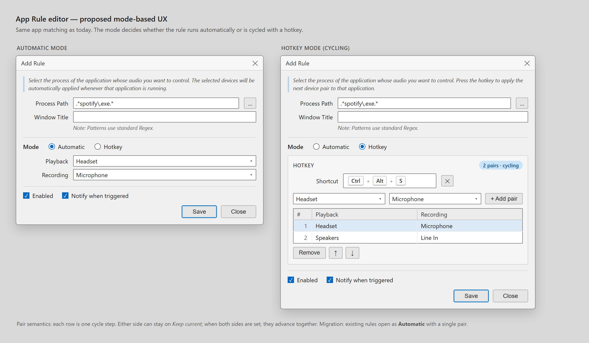

# App Rules: Automatic and Hotkey modes with device-pair cycling

**Status:** Draft v1 for review
**Author:** Hermes
**Branch:** `feat/2496-app-rule-hotkey` (rework of PR #2522)
**Base:** `origin/dev` (`6ce0c4d8`)
**Issue:** [Belphemur/SoundSwitch#2496](https://github.com/Belphemur/SoundSwitch/issues/2496) — "Assign hotkeys to switch audio output for specific applications"
**Related:** PR #2522 (current hotkey implementation, to be reworked)

---

## 1. Problem

Issue #2496 asks for a way to bind a hotkey to a specific application and cycle that application's audio devices, without changing the system default device.

App Rules already solve the "specific application" part:

- They match a process (and optionally a window title).
- They switch only that process' audio sessions through `AudioSwitcher.SwitchProcessTo`.
- The system default is never touched.

What they do not do is let the user trigger the rule manually or cycle between several device configurations. Today a rule is automatic only: it applies one playback device and one recording device whenever the process starts or comes to the foreground.

PR #2522 adds an optional hotkey to a rule, but keeps the single-device model. That covers "hotkey for an app", not "cycle through selected devices". It also makes the rule both automatic and manual at once, which is ambiguous: the user cannot tell whether the hotkey overrides the automatic application or simply repeats it.

The requested UX is a **mode** on the rule:

- **Automatic** — current behaviour, one device pair, applied on match.
- **Hotkey** — the rule is dormant until its hotkey is pressed; each press applies the next device pair to every matching running process.

## 2. Goals

1. Let the user choose `Automatic` or `Hotkey` per App Rule.
2. In `Hotkey` mode, let the user define an ordered list of device pairs and cycle through them with one hotkey.
3. Keep the existing app matching exactly as it is (process pattern, window pattern, case sensitivity, process picker).
4. Preserve existing rules through migration: every current rule becomes `Automatic` with a single pair built from its playback and recording devices.
5. Reuse the existing hotkey, notification, telemetry, and device-resolution infrastructure.
6. Keep the change contained to App Rules. Profiles stay the system-default concept.

## 3. Non-goals

- No profile refactor. Profiles keep their triggers and their system-default semantics.
- No third "automatic + hotkey override" mode. The two modes are exclusive; a hybrid can be added later if users ask.
- No per-app volume, per-app EQ, or per-session DSP.
- No new notification backend. The no-process message uses the existing notification pipeline.
- No cycle-index persistence across SoundSwitch restarts (see §6.3).
- No `DisplayName` field on rules in this iteration; the banner uses a generic message.

## 4. UX



The mockup above is the design artifact for this document. It shows the same `Add Rule` dialog in both modes.

### 4.1 Shared fields (unchanged)

- Process Path (regex or glob, with the `…` process picker).
- Window Title (optional regex or glob).
- Case sensitive.
- Enabled.
- Notify when triggered.
- Save / Close.

### 4.2 Automatic mode

- Mode radio: **Automatic** selected.
- One Playback combo and one Recording combo, exactly as today.
- The hotkey section and the pair list are hidden.
- The model is normalized to exactly one device pair.

### 4.3 Hotkey mode

- Mode radio: **Hotkey** selected.
- **Hotkey** field, using the existing `HotKeyTextBox` component, plus a clear button.
- A pair builder row: Playback combo + Recording combo + **Add pair**.
- An ordered pair table with columns `#`, `Playback`, `Recording`, showing device icons where available.
- **Remove**, **Move up**, **Move down** buttons.
- A `N pairs · cycling` badge next to the section title.
- The first pair is selected by default; the selected row is the one edited by the builder or removed by the buttons.

### 4.4 Mode switching

- `Automatic → Hotkey`: the current single pair seeds the pair list. The hotkey field becomes required before saving.
- `Hotkey → Automatic`: the first pair is copied into the single-device combos. If more than one pair exists, a confirmation explains that Automatic uses only the first pair and the other pairs will be removed. Confirming trims the list; cancelling leaves the mode unchanged.
- Switching modes is purely an editor operation; nothing is registered until the user saves.

### 4.5 App Rules list

Add a **Mode** column and keep the **Hotkey** column from PR #2522.

| Column | Automatic rule | Hotkey rule |
|---|---|---|
| Process Path | pattern | pattern |
| Window Title | pattern or empty | pattern or empty |
| Playback | device | first pair's playback, plus `(+N)` when more pairs exist |
| Recording | device | first pair's recording, plus `(+N)` when more pairs exist |
| Mode | `Automatic` | `Hotkey` |
| Hotkey | empty | `Ctrl+Alt+S` |

The `(+N)` suffix avoids adding a second pair-count column. Tooltips on the device cells can list every pair.

## 5. Data model

### 5.1 New types

```csharp
public enum AppRuleMode
{
    Automatic,
    Hotkey
}

public sealed class AppSoundRuleDevicePair
{
    // Either side may be null. A null side means "keep the current device".
    public DeviceInfo? Playback { get; set; }
    public DeviceInfo? Recording { get; set; }

    public bool HasAnyDevice => Playback != null || Recording != null;
}
```

### 5.2 `AppSoundRule`

```csharp
public AppRuleMode Mode { get; set; } = AppRuleMode.Automatic;

// Ordered cycle steps. Automatic uses exactly one; Hotkey uses all of them.
public List<AppSoundRuleDevicePair> DevicePairs { get; set; } = new();

// Only meaningful in Hotkey mode.
public HotKey? HotKey { get; set; }

// Legacy schema, kept deserializable for migration and cleared afterwards.
[Obsolete] public DeviceInfo? PlaybackDevice { get; set; }
[Obsolete] public DeviceInfo? RecordingDevice { get; set; }
[Obsolete] public string? PlaybackDeviceId { get; set; }
[Obsolete] public string? RecordingDeviceId { get; set; }
```

`Copy()` copies `Mode`, `HotKey`, and a deep copy of `DevicePairs` (the `DeviceInfo` instances are immutable enough to share; the pair objects must be new).

`ConfigurationManager` uses Newtonsoft.Json with `NullValueHandling.Ignore`, so clearing the legacy properties after migration keeps new saves clean.

## 6. Behaviour

### 6.1 Automatic mode

`AppSoundLockManager.ApplyRulesToProcess` filters to enabled rules with `Mode == Automatic` and applies `DevicePairs[0]`.

The existing `SwitchRuleDevice` self-heal is kept: if the stored `DeviceInfo` no longer matches a live device (driver update, id change), the resolver finds the live device, the pair's `DeviceInfo` is replaced, and the configuration is saved. The self-heal now mutates `DevicePairs[i]` instead of the rule-level properties.

`DevicePairs` is normalized to one pair when a rule is saved in Automatic mode. A malformed configuration with more pairs still uses the first one and logs a warning.

### 6.2 Hotkey mode

`AppSoundLockManager.ReloadHotkeys` registers the hotkey of every enabled `Hotkey` rule. `SettingsForm` calls it after add, edit, delete, enable, and disable. It also clears the in-memory cycle state.

Pressing the hotkey:

1. Resolve the rule from the hotkey map.
2. Enumerate running processes and keep those matching the rule (same `IsMatch` logic as the automatic path).
3. If none match: show the no-process notification and **do not advance** the cycle (§6.4).
4. If at least one matches: apply the current pair to every matching process, notify if enabled, record telemetry, and advance the cycle.

Automatic rules are never applied by the hotkey path, and Hotkey rules are never applied by the process/foreground path. The mode is the switch.

### 6.3 Cycling

- The cycle index is kept in memory per rule id: `Dictionary<Guid, int> _nextPairIndex`, guarded by the existing `_lock`.
- The first press applies pair `0`; the next press applies pair `1`; after the last pair it wraps to `0`.
- The index advances only when at least one process was switched. A pair whose devices cannot be resolved does not advance the cycle, and the failure is logged.
- Multiple matching processes (for example several Electron children) all receive the same pair and advance the cycle once.
- The index resets when:
  - the rule is edited,
  - the rule is enabled or disabled,
  - the rule's mode changes,
  - SoundSwitch restarts,
  - `ReloadHotkeys` runs.
- The index is **not** reset merely because the target application exited. The cycle is a user-visible toggle state, like the main device cycler.

### 6.4 Nothing running

When a Hotkey rule is pressed and no running process matches:

- Show a notification through the normal notification pipeline:
  - Title: `App Rules`
  - Text: `The application isn't running — nothing switched.`
- Do not advance the cycle index.
- Do not record an activation telemetry event (there was no switch).

The message is not gated by the rule's `Notify when triggered` flag. It is direct feedback to a manual action, not an automatic trigger. It still respects the global notification type: users who selected `None` will not see it.

Implementation:

- `NotificationManager.NotifyAppRuleNoProcess(AppSoundRule rule)`.
- `INotification.NotifyAppRuleNoProcess(AppSoundRule rule)`.
- `NotificationContentBuilder.BuildAppRuleNoProcess()` returns the `BannerData`.
- `NotificationBanner` shows the banner; `NotificationWindows` shows the toast/balloon; `NotificationSound` and `NotificationNone` no-op (there is no device to play a switch sound for).

### 6.5 Pair semantics

The pair list is flexible, as agreed during design review:

- A pair may set both sides, playback only, or recording only.
- A `null` side means **Keep current** for that side on that step.
- When both sides are set in the same pair, they advance together because they are one row.
- A pair with both sides `null` is invalid and cannot be saved.
- The rule must contain at least one valid pair.

Examples:

| Pair | Playback | Recording | Effect on press |
|---|---|---|---|
| 1 | Headset | Microphone | Switch both |
| 2 | Speakers | Keep current | Switch playback only; leave recording where it is |
| 3 | Keep current | Line In | Switch recording only; leave playback where it is |

### 6.6 Validation

On save:

- At least one of Process Path or Window Title must be set (existing rule).
- Automatic: exactly one pair with at least one device.
- Hotkey: a hotkey is required, and at least one pair with at least one device.
- Every pair must have at least one side set.
- The hotkey must pass `AppSoundLockManager.IsHotkeyAvailable(hotKey, ruleId)`, which checks other App Rules, profiles, and the OS registration.
- Two Hotkey rules may not have the same `ProcessPath` + `WindowName` combination. Two rules cycling the same target would fight over the same sessions; the second one is rejected with a localized message.
- Disabled rules keep their configuration but are not registered and do not auto-apply.

### 6.7 Hotkey registration

- Only enabled `Hotkey` rules with a non-null, enabled `HotKey` are registered.
- `ReloadHotkeys` unregisters everything it previously registered, then re-registers from the current configuration.
- A duplicate hotkey is logged and the first rule wins; the editor prevents this earlier through `IsHotkeyAvailable`.
- `Dispose` unsubscribes from `WindowsAPIAdapter.HotKeyPressed` and unregisters every rule hotkey.

## 7. Migration

`AppSoundRuleMigrator.Migrate` becomes a two-stage, idempotent migration.

1. Existing legacy id migration: `PlaybackDeviceId` / `RecordingDeviceId` → `PlaybackDevice` / `RecordingDevice` (unchanged).
2. Pair migration:
   - If `DevicePairs` is null or empty and `PlaybackDevice` or `RecordingDevice` is set, add a single pair with those devices.
   - If `Mode` is unset, default to `Automatic`.
   - If `HotKey` is set and `Mode` is still `Automatic`, this is a rule created by PR #2522: set `Mode = Hotkey` and keep the single pair.
   - Clear the legacy `PlaybackDevice`, `RecordingDevice`, `PlaybackDeviceId`, and `RecordingDeviceId` properties so they are not serialized again.
3. Return `true` if anything changed, so the caller saves the configuration once.

Migration examples:

| Before | After |
|---|---|
| `PlaybackDevice = Headset`, `RecordingDevice = Microphone` | `Mode = Automatic`, `DevicePairs = [(Headset, Microphone)]` |
| `PlaybackDevice = Headset`, no recording | `Mode = Automatic`, `DevicePairs = [(Headset, null)]` |
| PR #2522 rule with `HotKey = Ctrl+Alt+S` | `Mode = Hotkey`, `DevicePairs = [(Headset, Microphone)]`, `HotKey` kept |
| No devices at all | `Mode = Automatic`, `DevicePairs = []` (rule matches but does nothing; editor requires a pair on next save) |

## 8. Telemetry

- Successful switch: `TelemetryService.TrackAppRuleActivated(basename, "hotkey")` for Hotkey rules, `"process"` / `"foreground"` for Automatic rules.
- No switch (nothing running or no device resolved): no activation event.
- No new telemetry field is required. The existing `trigger` dimension distinguishes the modes.

## 9. Localization

Add to the base `SettingsStrings.resx` first; localized files can follow in the same PR where practical.

| Key | English value |
|---|---|
| `appSoundLock.rule.mode` | `Mode` |
| `appSoundLock.rule.mode.automatic` | `Automatic` |
| `appSoundLock.rule.mode.hotkey` | `Hotkey` |
| `appSoundLock.rule.hotkey` | `Hotkey` |
| `appSoundLock.rule.addPair` | `Add pair` |
| `appSoundLock.rule.removePair` | `Remove` |
| `appSoundLock.rule.moveUp` | `Move up` |
| `appSoundLock.rule.moveDown` | `Move down` |
| `appSoundLock.rule.keepCurrent` | `Keep current` |
| `appSoundLock.rule.pairCount` | `{0} pairs · cycling` |
| `appSoundLock.rule.noProcess` | `The application isn't running — nothing switched.` |
| `appSoundLock.rule.error.hotkeyRequired` | `Select a hotkey for this rule.` |
| `appSoundLock.rule.error.pairRequired` | `Add at least one device pair.` |
| `appSoundLock.rule.error.pairIncomplete` | `Each pair must select a playback or recording device.` |
| `appSoundLock.rule.error.hotkeyInUse` | `This hotkey is already used by another rule, profile, or application.` |
| `appSoundLock.rule.confirm.trimPairs` | `Automatic mode uses only the first device pair. Remove the other pairs?` |

The `pairCount` string is formatted with the number of pairs; the middle dot matches the mockup.

## 10. Files touched

| File | Change |
|---|---|
| `SoundSwitch/Model/AppSoundRule.cs` | `Mode`, `DevicePairs`, `HotKey`; legacy properties marked obsolete |
| `SoundSwitch/Model/AppRuleMode.cs` | New enum |
| `SoundSwitch/Model/AppSoundRuleDevicePair.cs` | New pair model |
| `SoundSwitch/Model/AppSoundRuleMigrator.cs` | Two-stage migration |
| `SoundSwitch/Services/AppSoundLockManager.cs` | Mode filter, hotkey registration, cycling, no-process notification, pair-aware self-heal |
| `SoundSwitch/UI/Forms/UpsertAppSoundLockRule.cs` / `.Designer.cs` | Mode radios, hotkey field, pair builder/list, validation |
| `SoundSwitch/UI/Forms/Settings.cs` / `.Designer.cs` | Mode and pair columns, reload hotkeys on every rule mutation |
| `SoundSwitch/Framework/NotificationManager/NotificationManager.cs` | `NotifyAppRuleNoProcess` |
| `SoundSwitch/Framework/NotificationManager/Notification/INotification.cs` | New notification method |
| `SoundSwitch/Framework/NotificationManager/Notification/NotificationBanner.cs` | Banner implementation |
| `SoundSwitch/Framework/NotificationManager/Notification/NotificationWindows.cs` | Toast implementation |
| `SoundSwitch/Framework/NotificationManager/Notification/NotificationSound.cs` | No-op |
| `SoundSwitch/Framework/NotificationManager/Notification/NotificationNone.cs` | No-op |
| `SoundSwitch/Framework/NotificationManager/Notification/NotificationContentBuilder.cs` | `BuildAppRuleNoProcess` |
| `SoundSwitch/Localization/SettingsStrings.resx` (+ localized) | New keys |
| `SoundSwitch.Tests/AppSoundRuleHotKeyTests.cs` | Rework for modes and cycling |
| `SoundSwitch.Tests/AppSoundRuleMigratorTests.cs` | Legacy → pair and PR #2522 → Hotkey cases |
| `website/src/usage/app-rules.md` | Document modes, pairs, cycling, no-process banner |
| `img/Documentation/AppRules Add.png`, `img/Documentation/AppRules.png` | Refresh screenshots after implementation |
| `docs/design/app-rules/2026-10-22-app-rule-modes.md` | This document |
| `docs/design/app-rules/app-rule-modes.png` | Mockup |

## 11. Test plan

### Automated

- Migration: legacy playback-only, recording-only, both, neither, and PR #2522 hotkey rule.
- `Copy()` deep-copies pairs and does not share mutable pair objects.
- Pair validation: both sides null rejected; one side accepted.
- Cycle state: first press → pair 0; wrap-around; no advance when no process matches; no advance when no device resolves; reset on reload.
- Mode filter: Automatic rules are skipped by the hotkey path; Hotkey rules are skipped by the process/foreground path.
- Hotkey registration: disabled rules are not registered; duplicate hotkeys keep the first; dispose unregisters everything.
- No-process notification: called once, cycle unchanged, no telemetry event.

### Manual

1. Build with `dotnet build SoundSwitch.sln -c Debug`.
2. Create an Automatic rule with one pair; confirm it still applies on process start and foreground.
3. Create a Hotkey rule with two pairs; confirm:
   - pressing the hotkey cycles pair 1 → pair 2 → pair 1,
   - only the target app's sessions change,
   - the system default is untouched,
   - the banner shows the switched devices.
4. Press the hotkey with the target app closed; confirm the "isn't running" banner and that the next press still starts at pair 1.
5. Switch a rule from Hotkey to Automatic with two pairs; confirm the trim prompt and the resulting single pair.
6. Edit a rule while it is mid-cycle; confirm the cycle resets.
7. Restart SoundSwitch; confirm hotkeys are registered without opening Settings and the cycle starts at pair 1.
8. Delete or disable a rule; confirm its hotkey is released.
9. Check light and dark themes, and the banner in and out of exclusive fullscreen.

## 12. Decisions

| # | Decision | Rationale |
|---|---|---|
| 1 | Keep App Rules; do not refactor profiles into app targets. | App Rules already own per-app routing. Profiles stay the system-default concept. A refactor would break a shipped feature and duplicate matching logic for no new capability. |
| 2 | Modes are exclusive (`Automatic` xor `Hotkey`). | Removes the ambiguity of PR #2522, where a rule was both automatic and manual. A hybrid can be added later if users ask. |
| 3 | Pairs are flexible: either side may be `Keep current`; at least one side must be set. | Today's rules can be playback-only or recording-only. Requiring both sides would be a regression. |
| 4 | Nothing running → banner and no cycle advance. | Direct feedback for a manual action; the next press starts at the same pair. |
| 5 | Rework PR #2522 instead of merging it first. | The schema changes from a single device to a pair list; shipping the hotkey first would require a second migration. |
| 6 | Automatic normalizes to one pair; Hotkey → Automatic trims after confirmation. | Keeps the automatic path simple and the UI honest about what is used. |
| 7 | The no-process message ignores the rule's `Notify` flag but respects the global notification type. | The flag describes automatic trigger notifications; the no-process message is manual-action feedback. Users who selected `None` still opt out globally. |
| 8 | No cycle persistence across restarts. | Matches the main device cycler's in-memory behaviour and avoids stale state after device changes. |

## 13. Future work

- Add an optional `DisplayName` to `AppSoundRule`, set by the process picker, and use it in the rule list and the no-process banner (`Spotify isn't running — nothing switched.`).
- Consider a third mode, `Automatic + Hotkey`, where the rule applies pair 1 on match and the hotkey cycles from there.
- Persist the cycle index per rule if users ask for it.
- Expose the pair list as a tooltip or expandable row in the App Rules list if `(+N)` proves too subtle.
