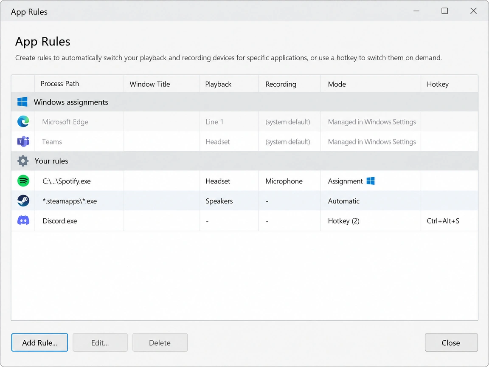
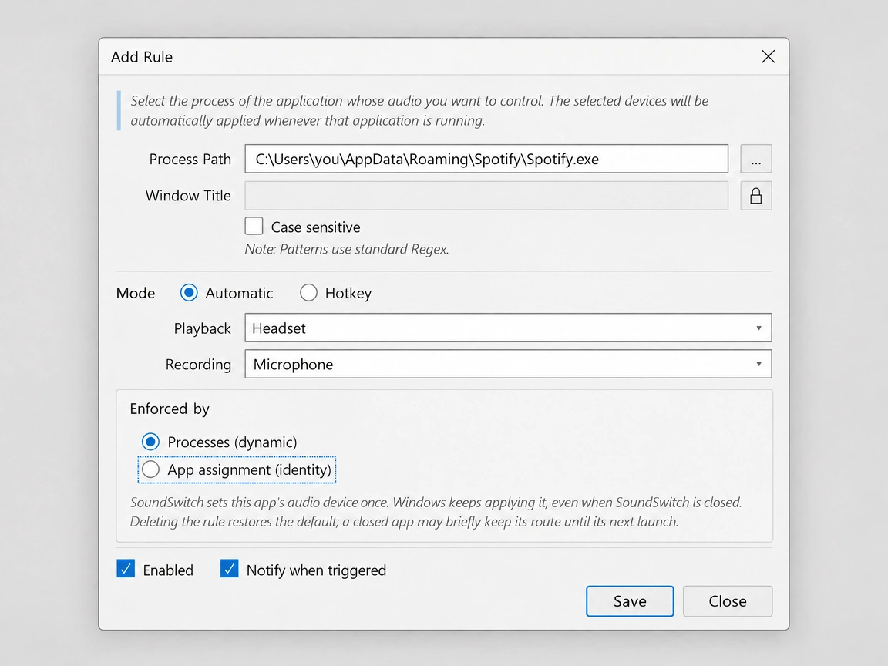

# App Rules: identity-based assignment rules synced with Windows

**Status:** Implemented on `adr-app-rules-picker` (revised 2026-11-04, see §0)
**Author:** GLM (OpenCode agent)
**Issue:** —
**Related:** `docs/design/app-rules/2026-11-03-app-rules-picker-own-device-list.md` (picker ADR; its §2.5 measured the engine applying persisted defaults by app identity), `docs/design/app-rules/2026-10-22-app-rule-modes.md` (rule modes)

---

## 0. Revision 2026-11-04 — no user-facing choice, both mechanisms together

The first implementation offered the mechanism as a per-rule choice (`Enforced by: Processes (dynamic) | App assignment (identity)`). **That was rejected as bad UX**: the user cannot be expected to know which enforcement model fits their app, and having two rules that look identical but behave differently is a trap. The radio pair is removed.

**The rule of the feature is now:** one rule, both mechanisms, no choice.

- A rule that **can** be an assignment — Automatic mode, one device pair, a concrete exe path, no window-title condition — **always writes the identity route** into Windows' store, so the engine keeps applying it even while SoundSwitch is closed.
- The **dynamic path stays on top as the fallback**: the process-start/foreground/hotkey triggers continue to apply the rule, which is what self-heals a stale device, covers a rule whose persisted route was removed by the user, and gives the immediate switch the user expects.
- Rules that **cannot** be an assignment (regex/glob pattern, window-title condition, several device pairs, Hotkey cycling) keep today's dynamic behaviour only. They are not worse off; they simply have no identity to persist.

`AppSoundRule.Enforcement` therefore becomes **derived state**, not a preference: `AppRuleAssignmentValidator.EnforcementFor(rule)` computes it on save and on migration. The editor has no control for it, and the list's Mode column no longer shows `Assignment` (every Automatic rule is the same Automatic rule).

Consequences that fall out of the revision:

| Area | Before (radio) | Now |
|---|---|---|
| Editor | "Enforced by" radios + validation errors when assignment was chosen with a bad pattern | no control; a one-line note explains that Windows will also remember the app's device |
| Save | user's choice persisted | eligibility decides; an ineligible rule silently stays dynamic |
| Delete | assignment rules restored the default, dynamic ones did not | **any** rule that wrote a route restores the default (§6.3), because every eligible rule owns an identity route |
| List | Mode showed `Assignment` | `Automatic` / `Hotkey` only |

Everything else in this document stands: the ledger (§6.4), the merge rule (§4), the engine-mediated writes, and the restore-default semantics including immediate deletion of a closed app's record.

---

## 1. Problem

Today every rule is *runtime-enforced*: SoundSwitch watches processes/foreground and calls `SwitchProcessTo` so long as it is running. Two visible costs follow directly from reading Windows' per-app store (picker ADR):

1. **SoundSwitch's own rules fight Windows' native behaviour.** The audio engine already re-applies persisted per-app defaults by exe identity (picker ADR §2.5): a routing written once into the persisted store is applied by the OS at session creation, before the first audio frame, and even while SoundSwitch is closed. Re-applying it from a monitor arrives later and adds a parallel mechanism to keep in sync.
2. **Deleting a rule does not restore the default.** When the user deletes a rule, SoundSwitch merely stops enforcing it — the app remains routed to the rule's device at the OS level until something else changes it. Users reasonably expect deletion to mean "the app goes back to its default".

Also, assignments the user makes in **Windows Settings → App volume and device preferences** are invisible in the App Rules list, though they are the exact same store the picker now reads.

## 2. Goals

1. Every rule that **can** be expressed as an identity assignment **also writes** that assignment once, so the audio engine enforces it — while the existing dynamic path stays in place as the fallback (§0). No user-facing choice.
2. Deleting (or disabling) an assignment rule **restores the default immediately**, whether the app is running or closed, and removes the app from Windows' own per-app list.
3. Show assignments that exist in Windows' store as read-only rows in the App Rules list (one-way sync — display, not import).
4. Reconcile assignment state on device changes so a rule pointing at a dead/plugged device self-heals.
5. Keep all existing rule behaviours (pair cycling, window-title matching, hotkey rules, notifications) working exactly as today.

## 3. Non-goals

- No direct registry writes or deletes against Windows' store (see §5.1 — the record-key hash could not be reversed); every store mutation goes through the audio engine's `IAudioPolicyConfig` while the app has a live session.
- No import of Windows-only assignments into editable SoundSwitch rules in this iteration (display only).
- No change to `Automatic`/`Hotkey` mode semantics, pair cycling, or window-title matching.
- No per-app volume, EQ, or autoplay detection.

## 4. UX





The mockups above are the design artifacts for this document. The App Rules list gains a read-only section above the user's rules — **merged, one identity may appear in only one place**:

| Section | Rows |
|---|---|
| **Your rules** | Every SoundSwitch rule, unchanged. A rule owns the persisted route of the app it targets — regardless of enforcement kind (a **Dynamic process rule's** `SwitchProcessTo` writes the same store, so its identity's record belongs to the rule, not to Windows). |
| **Windows assignments** | Only identities with a persisted route **not owned by any SoundSwitch rule** (user-made Windows Settings assignments): app name + `NameClean` device per side + `(edited in Windows Settings)` hint. No controls; clicking opens the Windows page (§6.5). |

Ownership rules (no duplicates, one source per app):

- A record is *ours* when it is covered by the ledger (§6.4 — which tracks writes from **any** enforcement kind, Dynamic included) **or**, as fallback for records written before the ledger existed, when it matches a Dynamic rule's target pattern (`IsMatch`).
- An identity managed by a rule never shows a second row in the Windows-assignments section; the rule's row is the single place the app's routing state is shown.
- When a rule-managed identity's record is edited from Windows' side, the rule **re-asserts** its pair on the next sighting — consistent with `Dynamic` behaviour since v1 (the rule re-applies on every sighting). Windows-side edits for rule-managed apps are therefore transient; deleting the rule is the documented way out (the editor helper text says so).

New control in the rule editor, only for `Automatic` rules (a follow-up to the picker's work, where the picker already knows the exe identity of rows — including the dimmed not-running ones):

- **No enforcement control.** The editor keeps Process Path, Window Title, Case sensitive, the mode radios and the device combos. There is no "Enforced by" choice (§0): an Automatic rule with a concrete path and no window title automatically also becomes a Windows assignment.
- When the rule is eligible, a one-line note under the device combos explains the behaviour: *SoundSwitch also registers this app's audio device with Windows, which keeps applying it even when SoundSwitch is closed.* The note is hidden for hotkey rules and for rules that cannot be an assignment.
- **No new validation errors.** Eligibility only decides whether the identity route is written; it never blocks saving. A regex or a window-title condition simply keeps that rule dynamic-only.

The rule list's **Mode** column from the modes ADR keeps its existing values: `Automatic` and `Hotkey (N)`. `Assignment` is not a mode the user picks and is no longer rendered.

## 5. Investigation

### 5.1 The persisted store cannot be written offline via public API

Writing/clearing an assignment for a *closed* app needs the engine API, which takes a pid (picker ADR §2.2/§2.3): `SetPersistedDefaultAudioEndpoint`/`GetPersistedDefaultAudioEndpoint` return `E_INVALIDARG` for a pid without audio. Windows' own page clearly manages closed apps (the store outlives processes, keyed by exe identity), but that capability is not exposed.

The store record's key is `<hash>_<N>` where `hash` plausibly derives from the exe path. A controlled ground-truth batch was written **by the audio engine itself** for nine identities (msedge / powershell / soundpad plus six copies of a scratch exe at different sub-paths and name lengths, so path sensitivity is proven: identical bytes at different directories hash differently), and the corpus was swept against standard 32-bit families — crc32 (plus init/xor variants and CRC-32C), adler32, FNV-1/FNV-1a, djb2, sdbm, MurmurHash3, xxHash32, Jenkins one-at-a-time, ELF/PJW/BKDR/JS/RS/DEK/rot/mul31-class strings, MD5/SHA-1/SHA-256 four-byte prefixes (both endiannesses) — each over ANSI/UTF-16LE bytes (with and without null terminators, lower/upper case, drive-letter and `\??\`/`\\?\` forms, forward slashes, sans-`Device` prefix, `_0`-suffixed inputs): **~1,500 combinations, none reproduces any sample**. The key naming stays un-reversed and offline record *writes* stay out of scope; **deletes do not need it**: the key is found by enumerating records and matching the exe path stored in each key's default value (§6.3), which is what makes restore-default immediate for a closed app. If offline writes ever become necessary, the next option is probing the policy factory's vtable for a path-oriented write method rather than more hash archaeology.

### 5.2 What the engine guarantees

- A record exists as long as `SwitchProcessTo` set it (picker ADR §2.2); it survives process exit and (observably) applies to fresh processes at session creation (§2.5).
- The in-memory override for a live process can be cleared by setting the *null* endpoint for its pid (same primitive `SetPersistedDefaultAudioEndpoint` with a zero HSTRING — the clear primitive used by the compiler's own `ResetAllSetEndpoint` is per-record only).
- Clearing while the app is *not running* is not possible via the same primitive (no pid). Deferred clears survive relaunch; the engine treats the store record transparently.

## 6. Design

### 6.1 Rule model

```csharp
public enum AppRuleEnforcement
{
    Dynamic,     // process/foreground/hotkey only
    Assignment   // identity route written into the persisted store, dynamic still applies
}

// AppSoundRule keeps the flag, but it is DERIVED state, never a user preference (ADR §0):
public AppRuleEnforcement Enforcement { get; set; } = AppRuleEnforcement.Dynamic;
// Only meaningful for Assignment: the exe identity resolved from the process/picker pick.
public string? AssignmentExePath { get; set; } // full path, e.g. C:\...\Spotify.exe
```

`AppRuleAssignmentValidator.EnforcementFor(rule)` is the single source of truth for the flag: it returns `Assignment` when the rule is eligible (Automatic, one pair, concrete path, no window title) and `Dynamic` otherwise. It runs on save and during migration, so a hand-edited or legacy config converges on the next save.

Eligibility (computed, not chosen — §0):

- `Assignment` needs `Mode == Automatic`, exactly one device pair, a concrete exe path (no regex/glob) and no window-title pattern. Anything else stays `Dynamic`; nothing is refused.
- Dynamic rules keep every matching behaviour (visibility, cycling, window rules).

Migration: the flag is normalized on every migration run — `EnforcementFor(rule)` recomputes it, so a config written by the radio-era build (where a user could pick `Assignment` for a regex rule) converges to the truthful value. No schema break: `Enforcement` remains in the JSON, unknown values fall back to `Dynamic` exactly like `AppRuleMode`.

### 6.2 Write path (assignment rule lifecycle)

The reconcile loop is a plain compare of **desired state** (rules) vs **actual state** (store + registry of our own records):

- On save/enable: the route is not written immediately if the app isn't running (no pid) — see lazy write in §6.3.
- On process sighting/foreground of `AssignmentExePath` (ProcessMonitor already exists): if the current persisted device differs from the rule's pair, apply it through the existing `SwitchRuleDevice` pipeline once; if the app wears its own stale persisted routing from a deleted rule, this write replaces it (a *Set* is authoritative).
- When a rule's device pair changes (edit): on the next sighting, or immediately if the app is running, write the new route (`SwitchProcessTo` per pid for each non-null side).
- `AppRuleDeviceResolver` self-heal continues to fix rule records whose device id changed before writing.

### 6.3 Delete / disable → restore default

Exactly the access pattern the user requested: **put back the default; never leave the route behind the user's back.**

- **Delete (or disable) an Assignment rule:**
  - *App is running:* clear the in-memory override via `SetPersistedDefaultAudioEndpoint(pid, …, null)` per pid for the flows the route covered — the live sessions return to the system default immediately.
  - *Record removal (both cases):* delete the identity's record key(s) from the store via `PersistedDefaultEndpointStore.DeleteRecords(exePath)`. The hash is not reversible, but the key is *located* by enumerating records and matching the exe path in the key's default value, so no hash is needed for a delete. Removing the key is what restores a **closed** app's default immediately (no pid, no engine call) and what makes the app disappear from Windows Settings' per-app list — clearing through the engine only empties the role values and leaves the record behind.
  - *Store not writable:* the `AssignmentLedger` entry stays and the clear is retried on the next sighting (the pending path is now the failure fallback, not the normal closed-app behaviour).
- **Delete while Windows made the assignment** (no SoundSwitch fingerprint): leave untouched (Windows owns it); the read-only section remains so the user can see it.
- The engine's own reconciliation after SoundSwitch's clear is automatic: no record, no route.

### 6.4 Ownership ledger (state)

```csharp
// New config section, e.g. Configuration/AssignmentLedger.cs
public sealed class AssignmentLedgerEntry
{
    public Guid RuleId { get; set; }             // the (now deleted) rule that wrote it
    public string ExePath { get; set; }          // volume-letter-less relative path
    public string? PlaybackDeviceId { get; set; }
    public string? RecordingDeviceId { get; set; }
    public DateTime WrittenAt { get; set; }      // diagnostics
}
```

- Entries are added whenever SoundSwitch writes a route **for any rule** — Assignment rules at reconciliation time, and Dynamic rules alongside each `SwitchProcessTo` match — so ownership survives enforcement kind; entries are removed when the route is superseded/cleared (rule edit, delete-clear, or sighting-clear).
- **Adoption (upgrade path):** versions before this ADR already wrote store records for Dynamic rules without any ledger. On first reconcile, a store record that no ledger entry covers but that matches an enabled rule's target (`IsMatch`, enforcement-agnostic) is *adopted*: a ledger entry is created for the owning rule. This keeps the merge rule of §4 (one identity, one row) true on upgrade without writing anything new to Windows' store.
- Reconcile distinguishes: a store record matching a ledger entry = *ours* → clear on rule deletion (and re-assert on rule-managed Windows-side edits, consistent with `Dynamic` re-apply since v1); a store record with no ledger entry and no matching rule = *the user's/Windows'* → display only, never touched.
- A ledger entry whose store record disappeared under it (user cleaned it in Windows settings) is dropped silently on reconcile — idempotent convergence.

### 6.5 Windows assignments section

- Source: `PersistedDefaultEndpointStore.ReadAll()` (exists), filtered to records not owned by any rule's `AssignmentExePath` (case-insensitive relative-path compare, same helper as the picker).
- Row action: opening the Windows page; the deep-link URI is verified at implementation time through the existing `SettingsPageHelper`-style pattern (`ms-settings:` page for per-app audio — verify the exact token for the OS build; if there is no good deep link, omit the link rather than hardcode a guess).
- Refresh: re-read on the list becoming visible (no background watcher).

### 6.6 Device-arrival self-heal (unplugged-device trap)

The Windows pitfall (mutes/hides apps whose persisted route points at a missing device — EarTrumpet #403) needs reconcile:

- On device arrival/removal (existing `AudioDeviceNotificationClient`), or on app sighting, for every Assignment rule and every ledger entry: resolve the recorded device; if unresolvable and the rule enabled → resolve a live replacement via `AppRuleDeviceResolver` and rewrite; if unresolvable and the source was a ledger entry whose rule still exists and is enabled → same; **if the rule is disabled/deleted → clear the record** (skip the app travelling misrouted to a dead device while it waits for its deferred clear).
- Users on SoundSwitch-closed periods still hit the Windows level behaviour for *their own* Windows-settings assignments — that is Windows' native, not ours to fix.

## 7. Telemetry

- `AppRuleActivated` gains no change for Dynamic rules; Assignment rules log `trigger = "engine"` on the first sighting after write (observable check, helps measure how many active routes the engine does correctly on its own).
- New `AppRuleAssignmentDeferredClear` event when a rule deletion's clear completes at a sighting, carrying `seconds elapsed` — the user-visible restore-default delay is the metric to watch.
- No PII; exe name only (same as existing rules' telemetry).

## 8. Localization

| Key | English value |
|---|---|
| `appSoundLock.rule.assignmentNote` | `SoundSwitch also registers this app's audio device with Windows, which keeps applying it even when SoundSwitch is closed. Deleting the rule restores the default immediately.` |
| `appSoundLock.rules.section.windows` | `Windows assignments` |
| `appSoundLock.rules.section.windowsHint` | `Managed in Windows Settings` |
The radio labels, the `Assignment` mode label and the two "assignment rule needs…" validation errors are **removed**: with no choice there is nothing to validate and no third mode to name.

## 9. Files touched

| File | Change |
|---|---|
| `SoundSwitch/Model/AppRuleEnforcement.cs` | New enum |
| `SoundSwitch/Model/AppSoundRule.cs` | `Enforcement`, `AssignmentExePath`; migrator normalization |
| `SoundSwitch/Model/AppSoundRuleMigrator.cs` | Unknown `Enforcement` values → `Dynamic` |
| `SoundSwitch/Model/AssignmentLedger.cs` | Ledger entries + persistence plumbing (where other config models live) |
| `SoundSwitch/Services/AppSoundLockManager.cs` | Enforcement filter, sighting-time reconcile write/clear, null-endpoint clears |
| `SoundSwitch/UI/Forms/UpsertAppSoundLockRule.cs` / `.Designer.cs` | Enforcement radio, validation, description |
| `SoundSwitch/UI/Forms/Settings.cs` | Windows-assignments read-only section, deep link, ledger refresh |
| `SoundSwitch/Framework/NotificationManager/NotificationManager.cs` (+ `Notification/*`) | (if any) new notification for conversion prompt — likely none |
| `SoundSwitch/Localization/SettingsStrings.resx` / `.Designer.cs` | §8 keys |
| `SoundSwitch.Tests/AppSoundRuleEnforcementTests.cs` | Model round-trip, migration normalization, ledger persistence, reconcile state machine |
| `docs/design/app-rules/2026-11-03-app-rules-identity-enforcement.md` | This document |
| `docs/design/app-rules/app-rule-editor-enforcement.webp` | Mockup: enforcement radios in the rule editor (§4) |
| `docs/design/app-rules/app-rules-list-windows-assignments.webp` | Mockup: list with merged Windows-assignments section (§4) |

## 10. Test plan

### Automated

- Migration: misspelled/missing `Enforcement` → `Dynamic` (idempotent).
- Ledger: entries survive config round-trip; stale entry dropped when its store record vanishes; deletion bookkeeping removes exactly the entry it wrote.
- Reconcile state machine (fakes for store read + per-pid policy client, fake store root as in the picker ADR tests): write-on-sighting only when route differs; delete-clear while running; deferred clear on next sighting; ledger-vs-user-record boundary (never clears a record we did not write); device-unresolvable behaviour (rewrite when rule enabled, clear when disabled/deleted).
- Validation: Assignment blocked with window title; Assignment blocked for regex process patterns (identity only).

### Manual

1. `dotnet build SoundSwitch.sln -c Debug`.
2. Create an Assignment rule for a *closed* app (via picker's dimmed row); launch the app — it routes to the rule's device without SoundSwitch running *after the first sighting*; close SoundSwitch entirely and re-launch the app — routing still applies (engine-owned).
3. Delete the rule while the app is open — audio returns to the default immediately (banner state coherent; defaults untouched).
4. Delete the rule while the app is closed — route persists until the next launch, then returns to default (measure with time).
5. Edit in Windows Settings on the same app: the App Rules list's Windows-assignments row shows the new device; SoundSwitch does not write over it while no corresponding rule exists.
6. Unplug the rule's device — next sighting yields the self-healed route (or a cleared route when the rule was disabled).
7. Legacy `Dynamic` rule regression: cycling hotkey, window-title rule, notifications, no-process banner — unchanged.

## 11. Decisions

| # | Decision | Rationale |
|---|---|---|
| 1 | **No user-facing enforcement choice: one rule does both** (identity route + dynamic fallback) whenever the rule is eligible. | Recorded in §0. Asking the user to pick an enforcement model is bad UX and creates two rules that look identical but behave differently. Eligibility is derivable from the rule itself, so the choice was never information the user had to supply. Rejected alternative: the per-rule `Enforced by` radio shipped in the first revision. |
| 1b | Assignment enforcement rides the engine; no registry writes (deletion excepted, §5.1). | The engine already applies by identity (picker ADR §2.5). Writing Windows' store by hand was ruled out after the hash crack failed (§5.1) — the deferred-clear semantics (§6.3) are the honest cost of staying inside the supported API. |
| 2 | Deletion restores the default **immediately**, closed app included, by deleting the identity's record key (enumerated, not hashed). | Deferring to the next launch left the app routed and still listed in Windows Settings, which is exactly the bug the owner reported. Deleting the key needs no reversible hash. The pending `ClearRequestedAt` entry remains only as the store-unwritable retry path. |
| 2b | Deletion applies to rules that wrote a route, regardless of how they were classified at the time. | Every eligible rule now writes one; leaving dynamic-era records behind after a delete reproduces the same "delete didn't reset it" complaint. | Matches the user expectation ("delete = go back to default"), and a one-launch delay beats either a destructive `ClearAll` or a fragile hand-edit. |
| 3 | SoundSwitch's written assignments are tracked in a local ledger, not in Windows' store. | The store must stay in the format Windows writes; the ledger keeps ownership side-state minimal and lets reconcile distinguish "ours" (clean it up) from "the user's/Windows'" (leave and just show it). |
| 4 | Windows-only assignments show as a read-only section; no import in this iteration. | One-way sync is nearly free (store read exists). Import needs conflict semantics (a user-crafted regex can't be reconstructed from an exe identity) and is better as its own decision if the section proves useful. |
| 5 | **Merge rule: one identity, one row.** A record covered by a SoundSwitch rule (ledger entry of any enforcement kind, or adopted pre-ledger record matching a Dynamic rule) never appears in the Windows-assignments section; the rule's row is its single source of truth. | Avoids showing the same app twice; the rule *is* the user's expression of intent for that app. Windows-side edits to a rule-managed identity are transient (the rule re-asserts on sighting), which keeps `Dynamic` v1 semantics coherent. |
| 6 | Keep `Dynamic` rules untouched; the new capability is additive (`Enforcement` value). | KISS / no crushing migration; all cycling, window-title, notification behaviour keeps its code path. Rules users actually want to persist become Assignments deliberately through a one-click editor option. |
| 7 | Deep-link to Windows' per-app page is validated at implementation time, else omitted. | Settings deep links are token-sensitive across builds; a wrong guess breaks a visible control. |

## 12. Future work

- Reverse-engineer the store key hash (or find a path-oriented method on the audio-policy factory), enabling offline write/clear of assignment records; then delete-of-closed-app becomes immediate and ProcessMonitor's sightings stop being load-bearing for this scenario.
- Migrate simple existing `Dynamic` rules (single pair, no window pattern) to Assignments automatically with user confirmation.
- Show the Windows-assignments section live (IMMNotificationClient-driven) if the manual refresh feels stale in testing.
- Import Windows-assignments-with-consent as `Dynamic`/Assignment rules (needs user-model of match patterns).
