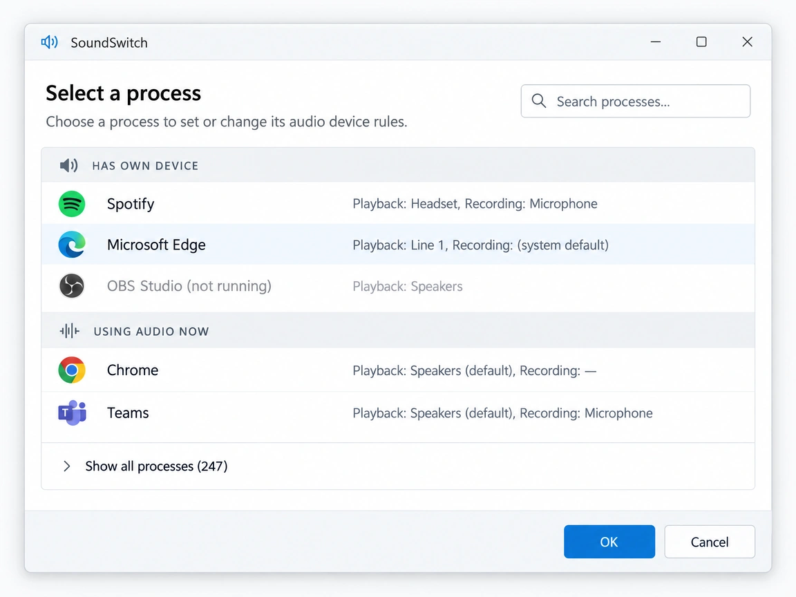
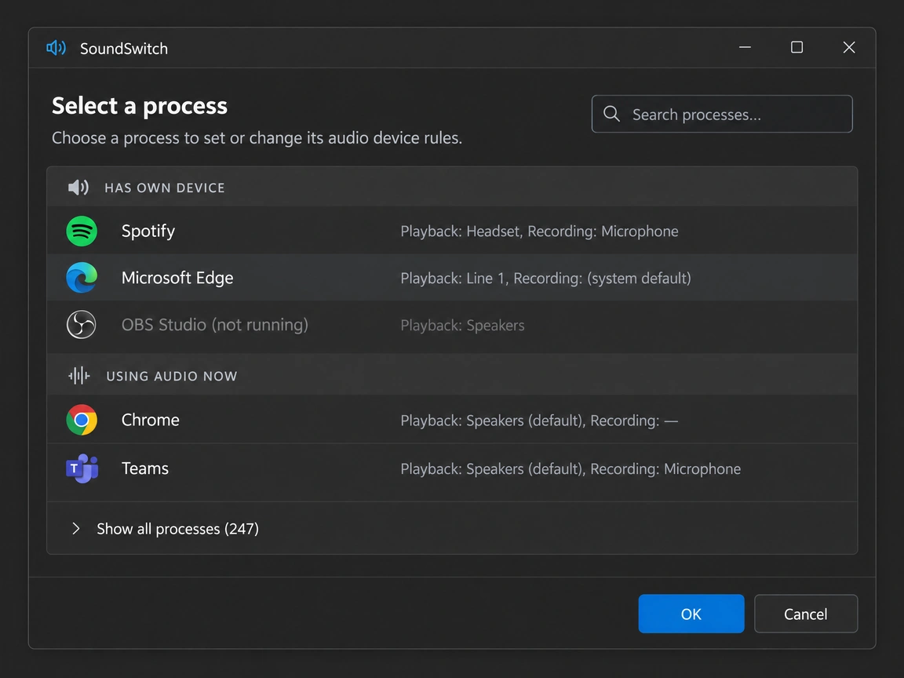

# App Rules picker: list apps that already have their own audio device set first

**Status:** Implemented on `adr-app-rules-picker`
**Author:** GLM (OpenCode agent)
**Issue:** —
**Related:** `docs/design/app-rules/2026-10-22-app-rule-modes.md` (App Rules modes)

---

## 1. Problem

The process picker in the App Rule editor (`SoundSwitch/UI/Forms/ProcessSelectionForm.cs`, `LoadProcesses`) starts from `Process.GetProcesses()` and shows **every process on the machine** — typically 150–300 rows, most of them system services and background apps that never produce audio. The user hunting for "Spotify" or "MS Teams" scrolls through noise, and the AppRules feature feels secondary in their own Settings.

Windows already solves the same discovery problem. **Windows Settings → System → Sound → "App volume and device preferences"** (Windows 10) and the per-app dropdowns in the **Windows 11 volume mixer** show a short, audio-relevant list of apps — and the apps that already **have their own playback/recording device assigned** are exactly the apps a user work with:

- apps whose per-app device the user already chose in Windows Settings, or
- apps whose device a previous SoundSwitch App Rule assigned.

Users expect the App Rules picker to look like that list. Today it looks like Task Manager's Details tab.

## 2. Investigation

This decision depends on what Windows actually stores and exposes. Verified against the EarTrumpet source (`gh repo clone File-New-Project/EarTrumpet`) and **by experiment on this machine** (Windows 11 25H2, build 26200 → 26200.9711), driving SoundSwitch's own interop (`ExtendedPolicyClient` → `IAudioPolicyConfig`).

### 2.1 What EarTrumpet builds (reference implementation)

EarTrumpet never reads Windows Settings' list. Its app list comes from **audio sessions**:

- `AudioDeviceManager` enumerates active endpoints; each `AudioDevice` enumerates sessions via `IAudioSessionManager2`/`IAudioSessionEnumerator` (`AudioDeviceSession`, `SoundSwitch.Audio.Manager/AudioDevice.cs` has the same mechanism).
- `AppItemViewModel` (session-backed) decorates itself with `GetDefaultEndPoint(ProcessId)` (`EarTrumpet/DataModel/WindowsAudio/Internal/AudioDeviceSession.cs:311`, `UI/ViewModels/AppItemViewModel.cs:42`) — the "persisted output device" shown under an app. It even **force-moves the session** to the persisted device after a UWP bug workaround (`SyncPersistedEndpoint`).
- `IAudioPolicyConfigFactory` exposes exactly three methods: `SetPersistedDefaultAudioEndpoint`, `GetPersistedDefaultAudioEndpoint` (both **per processId**), and `ClearAllPersistedApplicationDefaultEndpoints` (`EarTrumpet/Interop/MMDeviceAPI/IAudioPolicyConfigFactory.cs`). **No enumeration API exists.**

### 2.2 What Windows actually persists (experiment)

Setting a per-app default for a live audio-capable Edge pid through `AudioSwitcher.SwitchProcessTo` wrote this registry record:

```
HKCU\Software\Microsoft\Multimedia\Audio\DefaultEndpoint\505ccc8f_0
    (Default)  REG_SZ  \Device\HarddiskVolume3\...msedge.exe          ← app identity
    000_000    REG_SZ  \\?\SWD#MMDEVAPI#{0.0.0.00000000}.{guid}#{iface} ← eConsole device
    001_000    REG_SZ  ...                                             ← eMultimedia device
    002_000    REG_SZ  ...                                             ← eCommunications device
    NNN_000_p  REG_SZ  {GUID}                                          ← paired metadata value
```

- Record key shape: `<hash of exe path>_<flow>` (`_0` appeared for render experiments); one key per app per flow.
- The record **outlives the process** (observed with a transient pid) — this is the store behind Windows Settings' "App volume and device preferences" list, which also lists non-running apps.
- On this machine, before the experiment, the store was **empty** — Windows' per-app page had no user-assigned devices, confirming the store is written only when a per-app device is set (by Windows Settings or by SoundSwitch's rules; indistinguishable).

### 2.3 `GetPersistedDefaultAudioEndpoint` semantics (measured)

| State | Result |
|---|---|
| pid has no audio session (incl. dead pids) | `E_INVALIDARG` (0x80070057) — SoundSwitch maps this to `HRESULT.PROCESS_NO_AUDIO` → `null` |
| pid has audio sessions, no persisted device | `S_OK` with **empty** deviceId |
| pid has a persisted device | `S_OK` with the unpacked MMDevice id (verified immediately after `SwitchProcessTo`) |

So one getter call per pid doubles as a *session liveness* probe — but only covers running processes.

### 2.4 Constraint discovered

`SetPersistedDefaultAudioEndpoint` (and any extended-policy call, including per-pid Get) must run under the audio COM apartment discipline: the same call that `E_INVALIDARG`s when issued from a bare thread succeeds through `AudioSwitcher`'s `ComThread.Invoke` on this build. This design's picker path issues **no** extended-policy calls at all (§6.1.1); the constraint applies to the Future-work fallback and to rule application, which already rides `ComThread`.

### 2.5 The engine applies persisted defaults by app identity (measured)

A follow-up experiment to answer "do rules still need to wait for the process to appear?": a scratch `soundpad.exe` was launched, its persisted default set to Line 1 via `AudioSwitcher.SwitchProcessTo`, it was killed, and launched again with **no SoundSwitch involvement**:

- The fresh process' render session was already on Line 1 (`AudioSwitcher.GetSessionDeviceId` — the real session, not just policy state), and `GetPersistedDefaultAudioEndpoint` reports the persisted device for the fresh pid. The audio engine resolves the pid → exe identity and **re-applies the persisted default itself at session creation**, without any external caller, exactly like plain "App volume and device preferences" assignments behave.
- Implication: for a plain, always-active Automatic assignment, SoundSwitch's process-arrival/foreground triggers are redundant — the OS does the enforcement natively, at higher priority (before the first audio session is created), and even when SoundSwitch isn't running.
- Why this design still keeps process-triggered application (KISS, no semantic break inside this iteration):
  1. **Disabling/unclearing a rule would need identity-level clears.** The public `IAudioPolicyConfig` surface can only Set/Get/ClearAll per pid — with the app not running there is no pid, so an identity-enforcing rule could not be reliably disabled again via supported API (a live record persists until manually cleared or overridden). Rules must remain uninstallable-by-user; process-applied overrides stay session-scoped on the SoundSwitch side.
  2. The other rule behaviours are live-only: pair cycling (one route at a time per rule), window-title matching, "isn't running" feedback, notifications, and disable semantics.
  3. Enforcing at identity level makes SoundSwitch's state *permanently* visible-and-alive in Windows Settings even after "disable", which is a user-visible semantic jump.
  Identity-level enforcement is therefore a candidate follow-up ADR ("App Rules write the persisted store at save time; engine applies; rules become identity-based"), not a silent change inside this iteration (§10, Future work).

## 3. Goals

1. Show the apps that already **have their own audio device set** (render or capture) as the first, highlighted group in the picker — the same apps Windows Settings lists with a device assignment. The persisted store outlives processes, so this group must also include apps that are **not running** (shown dimmed), exactly like Windows Settings does.
2. Second group: apps currently producing/consuming audio (active sessions) but still on the system default.
3. Keep every remaining process available — behind a default-collapsed "Show all processes" toggle — so no existing capability is lost.
4. Fill "playback"/"recording" columns for groups 1–2 from real data (persisted default, then session device), which the picker already displays.
5. No new COM machinery in the picker: the new classification reads the persisted store (plain registry, §6.1) and reuses the session/device display calls that already exist today — no new policy-COM surface.

## 4. Non-goals

- No change to rule matching (`AppSoundLockManager.IsMatch`) or to how rules apply devices.
- No attempt to mirror Windows' pinned-UWP-app heuristics or to display UWP "app ids".
- No new config setting; the collapsed/expanded toggle is UI state, not persisted.
- Windows builds pre-1709 (no `IAudioPolicyConfig`) keep today's flat list for the *live* groups; the registry store still lists persisted entries where it exists.

## 5. UX





The mockups above are the design artifacts for this document. The picker becomes a three-group list, newest signal first:

| Group label | Contents | Column data |
|---|---|---|
| **Has own device** | Apps with a persisted per-app default for `eRender` or `eCapture` — i.e. the apps listed in Windows settings as having their own audio device. Read from the persisted store (§6.1), so this includes apps that are **not currently running** — shown as dimmed rows (`<app> (not running)`), matching Windows Settings. A row that matches a running process is selectable as usual; a dimmed row is selectable too (creating a rule for a closed app is a legitimate workflow, §6.3) | The assigned device name per side, straight from the store's device token (`NameClean` of the endpoint); missing side falls back to session device → system default |
| **Using audio now** | Processes with an active session on any endpoint, not covered above | Session device per side |
| **Show all processes** *(collapsed toggle)* | The rest, today's full list | Today's per-side display logic, unchanged |

- The mockups show both app themes. Implementation must resolve every colour through the existing theme accessors (`SettingsForm.Get*Color` / `WindowsThemeHelper`) so light and dark mode both work — never inline colour literals (repo guardrail, dark-theme ADR `docs/design/ui/2026-09-03-dark-theme-winforms.md`).
- Groups are list sections in the same grid (a group-header row per section); the filter box (`txtFilter_TextChanged`) filters within all groups and keeps group headers.
- Selecting a row behaves exactly as today (`SelectedProcessName/Path/WindowTitle`) — the reorganization is presentation-only.
- The sorting must not depend on process-enumeration order; each group is sorted by process name.

## 6. Design

### 6.1 Reading the persisted store (primary source)

New helper in `SoundSwitch.Audio.Manager` (own class, `ComThread`-free since it is pure registry read; UI-touching stays in the app layer):

```csharp
public sealed class PersistedDefaultEndpointStore
{
    // One entry per {app, flow} record in
    // HKCU\Software\Microsoft\Multimedia\Audio\DefaultEndpoint\<hash>_<flow>
    public sealed record Record(string ExePath, EDataFlow Flow, IReadOnlyDictionary<ERole, string> DeviceIds);

    public IReadOnlyList<Record> ReadAll();
}
```

Layout verified by experiment (§2.2): the `(Default)` value is the exe path (`\Device\HarddiskVolume...\app.exe`), and values named `<role-index>_000` hold the full MMDEVAPI device token; `role-index` is `000`/`001`/`002` for eConsole/eMultimedia/eCommunications. Values that do not match the pattern are ignored (forward compatibility); a record with no recognizable device token is skipped entirely — the token is the only direction signal, so a tokenless record has no flow and no per-flow column data (refines §6.1's draft "empty map" option). `DeviceIds` hold the **unwrapped** MMDevice id (`{0.0.0.00000000}.{guid}`, what `GetUsedDevice`/the device cache resolve), not the raw `\\?\SWD#MMDEVAPI#…` token; the full token is only used to derive direction and role mapping.

One fact, one source: **the device's direction comes from the token itself** (interface suffix `#e6327cad…` = render, `#2eef81be…` = capture) — not from the undocumented numeric suffix of the record key, which has not been reverse-engineered and is not relied upon anywhere.

Mapping a record to UI data: the exe path in the store is in NT device form (`\Device\HarddiskVolume3\...`). Matching against the picker's running processes therefore compares on the **remainder after the volume prefix**: strip a leading `\Device\HarddiskVolume<N>\` from the store path and compare the remaining relative path case-insensitively (suffix match) with each process path from `MainModule.FileName`. This avoids drive-letter guessing while still matching the right process. A record with no matching running process becomes a dimmed not-running row that keeps the full store path as its identity, and the dialog shell already tolerates per-row data gaps.

Rows in the picker get their device *names* from the existing device cache (`NameClean` per repo rules), not by activating endpoint data blindly.

### 6.1.1 No live policy queries in v1 (KISS)

The picker's classification needs **no new COM surface**: the store read (above) already classifies running and non-running apps, and the experiment showed the engine flushes the record immediately on `SwitchProcessTo` (§2.2). The planned per-pid batched `GetProcessIdsWithOwnDevice` (`AudioSwitcher`) is therefore **dropped from this iteration**: single caller, second mechanism for the same fact (violates the DRY > KISS ordering in the repo guidance). The grouped views use only what already exists today — `GetProcessDeviceMap` for the "Using audio now" session columns.

If the registry read ever proves stale or unreliable in the field, the fallback is a batched per-pid `GetDefaultEndPoint` sweep inside a single `ComThread.Invoke` — remember the apartment constraint (§2.4). Tracked under Future work.

### 6.2 Grouping in the picker

`ProcessSelectionForm.LoadProcesses` keeps its current enumeration (`Process.GetProcesses()`, icon extraction, dedupe — unchanged, icons remain the real cost) and gains a classification pass:

1. `records = PersistedDefaultEndpointStore.ReadAll()` — pure registry read, no COM.
2. Collect active-session pids / per-process devices from `AudioSwitcher.GetProcessDeviceMap` (already loaded today for the display columns).
3. Classify rows:
   - a running process whose persisted `GetUsedDevice` result (today's existing per-pid persisted read, already used for the display columns) returns a device, **or** whose path suffix-matches a store record → **Has own device** (running);
   - store records whose exe path matched **no** running process → **Has own device** (dimmed, `(not running)`, still selectable — the rule editor only needs the `.exe` name, so NT-form store paths remain compatible);
   - other processes with active sessions → **Using audio now**;
   - everyone else → **All processes**, behind the collapsed toggle.

The store records are the source of truth for "this app has a device assignment"; the pre-existing per-pid `GetUsedDevice` read (display columns, unchanged) freshly confirms running-process devices.

Rows keep carrying their per-side device names, computed as today (`GetUsedDevice` → `GetProcessDeviceMap` → system default), so no display logic changes.

### 6.3 Edge cases

- **Elevated processes** whose path/icon cannot be read today behave as now; their audio data may allow classifying them even when the icon fails.
- **Pre-1709 / store absent:** older builds have neither per-app persisted defaults nor the `DefaultEndpoint` store; the two highlighted groups come up empty and the picker behaves like today's flat list. No `IAudioPolicyConfig` queries are made in either case (§6.1.1).
- **Dead pids between enumeration and query:** a pid that exits before the batched query is simply not classified as running; its store record still surfaces it.
- **Stale records:** uninstalled apps can leave `DefaultEndpoint` records forever (Windows keeps them too). They appear as not-running dimmed rows; creating a rule from such a row is harmless (it just won't match until the app exists again). SoundSwitch **never writes to** the store's open shape outside of its existing `SwitchProcessTo` path.
- **Pre-existing assignment by Windows Settings:** identical store, identical row; no special-casing (verified: SoundSwitch's `SwitchProcessTo` writes the same record shape Windows' UI writes).
- **Schema drift (the store is undocumented):** `ReadAll` ignores records/values that don't match the observed layout, so unexpected future shapes degrade to "no rows", never a crash.
- **Writing:** unchanged — apps still get their device through `AppSoundLockManager.SwitchRuleDevice` → `AudioSwitcher.SwitchProcessTo`; the store gets updated by the audio engine exactly as today (no direct writes; not least because direct writes would need elevated/audio-engine assumptions we don't have).

## 7. Files touched

| File | Change |
|---|---|
| `SoundSwitch.Audio.Manager/PersistedDefaultEndpointStore.cs` | New: read-only enumeration of `HKCU\...\Multimedia\Audio\DefaultEndpoint` records — §6.1 |
| `SoundSwitch/UI/Forms/ProcessSelectionForm.cs` | Classification pass, group sections, dimmed not-running rows, "Show all processes" toggle, group-aware filter |
| `SoundSwitch/UI/Forms/ProcessSelectionForm.Designer.cs` | Toggle control, group-header row styling |
| `SoundSwitch/Localization/SettingsStrings.resx` / `.Designer.cs` | Picker group labels, "(not running)" suffix, toggle text |
| `SoundSwitch.Tests/PersistedDefaultEndpointStoreTests.cs` | Record parsing round-trips against an injected scratch registry root — §6.1 |
| `docs/design/app-rules/2026-11-03-app-rules-picker-own-device-list.md` | This document |
| `docs/design/app-rules/app-rule-picker-own-device.webp` | Mockup, light theme (§5) |
| `docs/design/app-rules/app-rule-picker-own-device-dark.webp` | Mockup, dark theme (§5) |

## 8. Test plan

### Automated

- `PersistedDefaultEndpointStore` parsing: fixture records (exe default value + `<NNN>_000` device pairs), direction derived from the token's interface suffix, malformed values ignored, missing fields tolerated, unknown value shapes skipped. The store path is an injected constructor parameter so tests run against a scratch root and never touch the real store.

### Manual

1. `dotnet build SoundSwitch.sln -c Debug`.
2. With a rule previously applied to an app: open the picker — that app appears at the top under **Has own device** with its assigned device shown, and remains listed (dimmed, "not running") after the app exits — verified possible: the persisted registry record outlives the process (§2.2).
3. Set an app's device in **Windows Settings → App volume and device preferences**, then open the picker — the same app appears in **Has own device** with the device Windows itself assigned.
4. Play audio in an app without its own device; confirm it lands in **Using audio now** (session device shown while it plays).
5. Collapse the toggle; confirm the full process list is still reachable and the filter searches all groups.
6. Confirm dialog opens without a perceptible freeze on a machine with ~250 processes (the store read is a plain registry pass; no new COM calls are added).
7. Toggle Windows light/dark app mode: all picker colours come from the theme accessors — verify both themes match the two mockups.
8. Regression: creating a rule from a **dimmed not-running** row (uninstalled app) works and simply doesn't match until the app exists.

## 9. Decisions

| # | Decision | Rationale |
|---|---|---|
| 1 | Read the persisted store (`DefaultEndpoint`) directly for the "Has own device" group instead of replicating Windows' heuristic list. | The store **is** the truth behind Windows Settings' list (§2.2), it enumerates cleanly from `HKCU`, and it includes non-running apps that per-pid queries cannot see. Schema is undocumented — we mitigate by ignoring unknown shapes (§6.1) and never writing the store outside the engine-mediated path. |
| 2 | No new policy-COM surface in this iteration — classification uses only the store read plus the existing session/device display calls. | The planned batched per-pid query was a second mechanism for the same fact with a single caller (violates DRY > KISS). The store flushed immediately in the experiment (§2.2), so it is the source of truth; the live-query fallback is kept under Future work with its `ComThread` constraint (§2.4). |
| 3 | Groups, not a hidden filter — "Show all processes" keeps every current capability visible. | Today's flat list is a *discovery* failure, not a capability failure; hiding anything behind search would be a regression. |
| 4 | Presentation-only change to the picker. | Matching and applying logic is untouched, so rules created from the old picker stay fully compatible. |
| 5 | Remove a persisted record only through the audio engine's own API (`ClearAllPersistedApplicationDefaultEndpoints` — Troubleshooting), never by deleting records from the picker. | Windows owns the store's undocumented format; SoundSwitch already ships a troubleshooting reset via `ExtendedPolicyClient.ResetAllSetEndpoint`. Per-record deletes would create a destructive path against it. |

## 10. Future work

- If the registry store proves stale or unreliable in the field, add a batched per-pid `GetDefaultEndPoint` sweep through `ComThread.Invoke` as a re-confirmation pass (§6.1.1); the `ComThread` apartment constraint (§2.4) applies.
- Derive the store's `<hash>_<N>` key naming from the record contents if a reverse-engineered, stable hash emerges (useful for targeted writes; reading only needs the current enumerate-all approach).
- **Identity-level rule enforcement** (candidate follow-up ADR): when a rule is saved/enabled, write its device pair to the persisted store once and let the audio engine apply it at session creation (measured: §2.5). The App Rules process monitor, foreground trigger, and "isn't running" paths stop being needed for plain Automatic assignments; cycling/window-title rules keep the process path. Gate: a supported way to clear a not-running app's rule (endpoint with clear-by-identity or accepted use of `ClearAll`).
- Add a "Check Windows settings" deep-link label on the **Has own device** group header, jumping users to the Windows page that shows the same list.
- Propagate group classification into the hotkey-mode flow (`ApplyRuleToRunningProcesses` logs) for diagnostics parity.
- Consider flagging rows whose persisted device is not currently resolvable (device unplugged) in the **Has own device** group, so the rule's self-heal (`AppRuleDeviceResolver`) is visible before save.
